# Evidencias - Publicación en IIS (On-Premises, Windows Server)

> Nota: la publicación se realizó en **Windows Server** en lugar de Windows 11 (consultado con el docente).
> En Windows Server, IIS se instala como rol desde PowerShell / Administrador del servidor; la configuración del sitio y del Application Pool es la misma.

- **Responsable:** Jhon Eduardo Zabala Garzon (integrante B)
- **Servidor:** `WIN-DNK6M3AKO19` (Windows Server, IP local `192.168.11.81`)
- **Fecha de publicación inicial:** 2026-10-27
- **Fecha de actualización (versión final):** 2026-10-30

### Resumen de la configuración

| Elemento | API (Backend) | Tienda (Frontend Blazor WASM) |
|---|---|---|
| Sitio IIS | `ShopCore-API` | `ShopCore-Web` |
| Application Pool | `ShopCoreApiPool` (No Managed Code, Integrated) | `ShopCoreWebPool` (No Managed Code, Integrated) |
| Ruta física | `C:\inetpub\shopcore-api` | `C:\inetpub\shopcore-web` |
| Binding | `https` puerto `7000` (certificado autofirmado `ShopCore`) | `https` puerto `8000` |
| Punto de entrada | Módulo `AspNetCoreModuleV2` (`web.config`) | `index.html` (Default Document) |
| Base de datos | SQL Server Express `localhost\SQLEXPRESS`, login SQL `shopcore` | — |

---

## 1. Preparación del servidor

### 1.1 Rol de IIS instalado
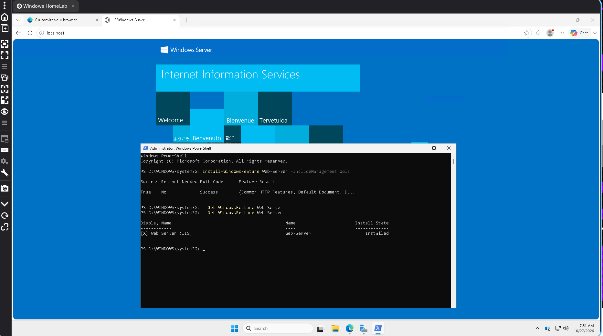

Instalación del rol con `Install-WindowsFeature Web-Server -IncludeManagementTools` (resultado `Success`) y verificación con `Get-WindowsFeature Web-Server` (`Installed`). Al fondo, la página de bienvenida de IIS en `http://localhost`.

### 1.2 ASP.NET Core 8 Hosting Bundle
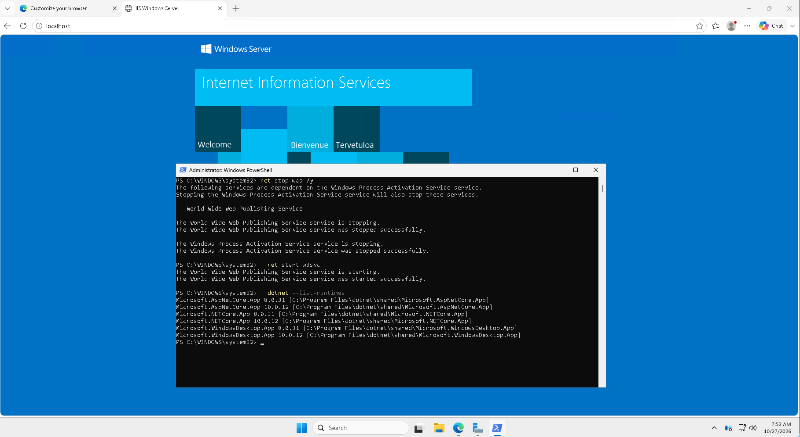

Reinicio de los servicios de IIS (`net stop was /y` y `net start w3svc`) después de instalar el Hosting Bundle, y `dotnet --list-runtimes` mostrando `Microsoft.AspNetCore.App 8.0.31`.

### 1.3 URL Rewrite Module
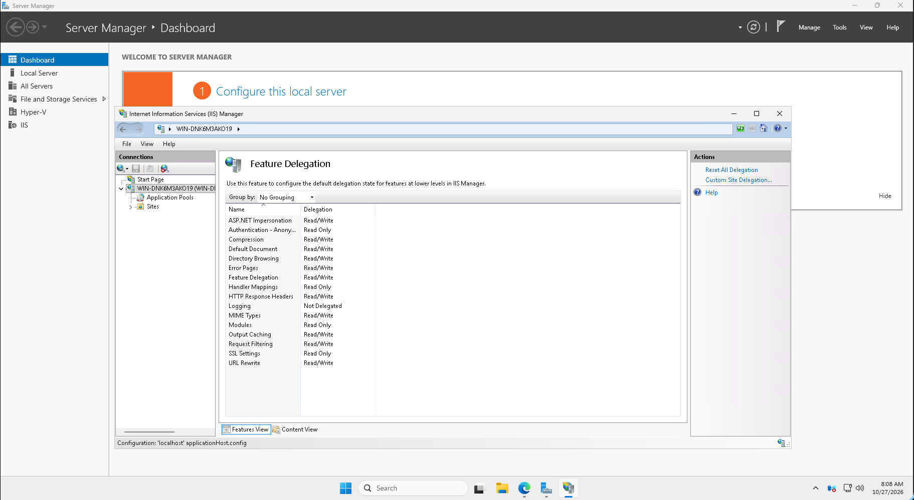

Administrador de IIS, en el nodo del servidor `WIN-DNK6M3AKO19` (Feature Delegation): aparece la característica **URL Rewrite**, necesaria para que IIS sirva la aplicación Blazor WebAssembly.

### 1.4 SQL Server Express
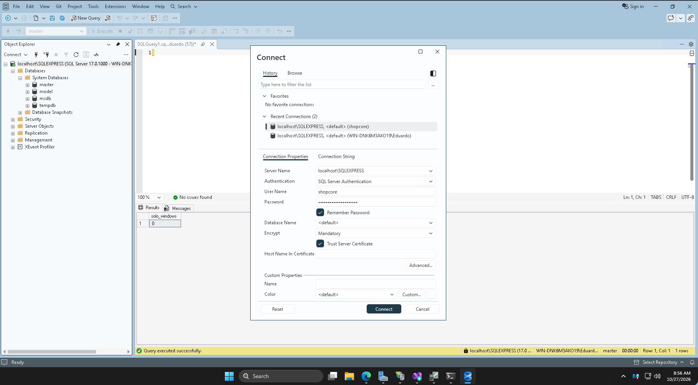

SQL Server Express (`localhost\SQLEXPRESS`) administrado desde SSMS. Conexión con **SQL Server Authentication** con el usuario `shopcore` (contraseña oculta) y *Trust Server Certificate* habilitado.

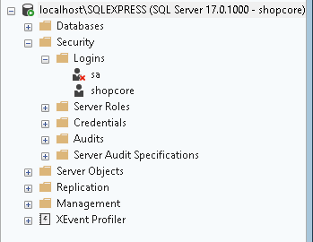

Login SQL `shopcore` creado en *Security → Logins*. La aplicación lo usa para crear la base `ShopCore` al iniciar.

---

## 2. Publicación inicial (versión actual: API + Frontend separados)

### 2.1 Generación de la versión publicable (`dotnet publish`)
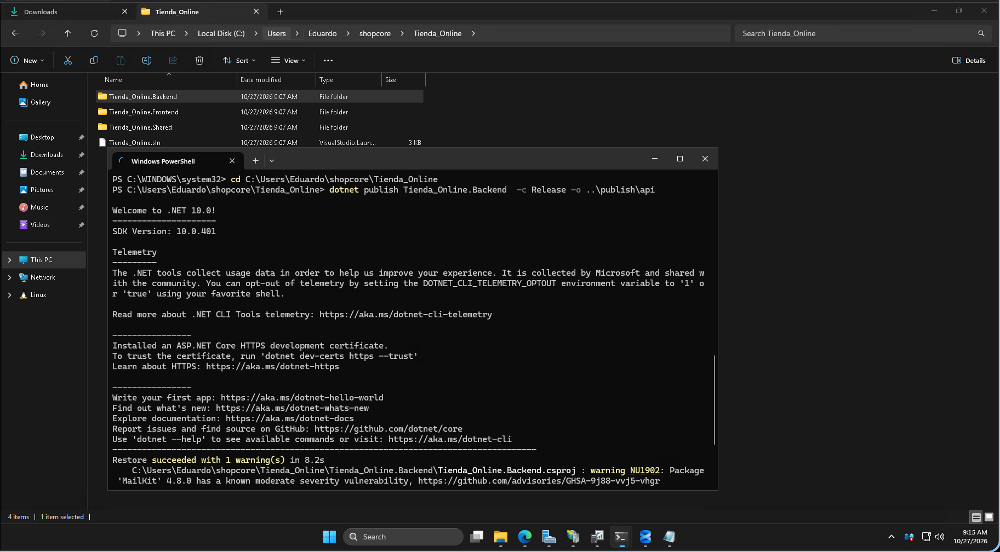

Ejecución de `dotnet publish Tienda_Online.Backend -c Release -o ..\publish\api` desde la carpeta de la solución `C:\Users\Eduardo\shopcore\Tienda_Online`.

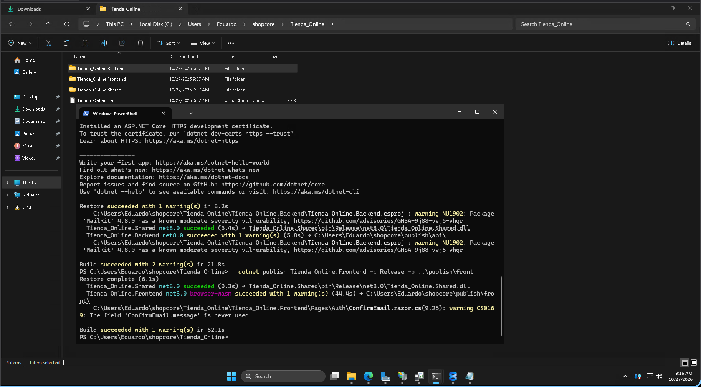

Publicación exitosa del Backend (`publish\api`) y del Frontend Blazor WebAssembly (`publish\front`) en modo Release (`Build succeeded`). Los archivos se copiaron luego a `C:\inetpub\shopcore-api` y `C:\inetpub\shopcore-web`.

### 2.2 Application Pools dedicados
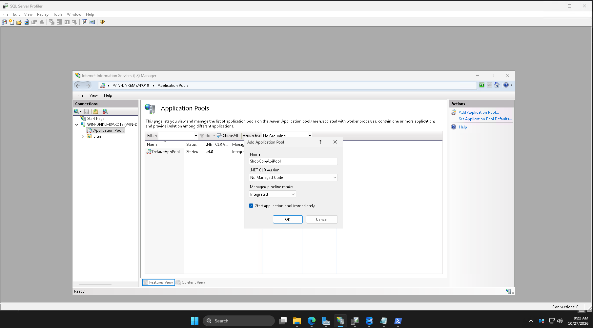

Creación de `ShopCoreApiPool`: .NET CLR **No Managed Code** (ASP.NET Core no usa el CLR clásico) y pipeline **Integrated**.

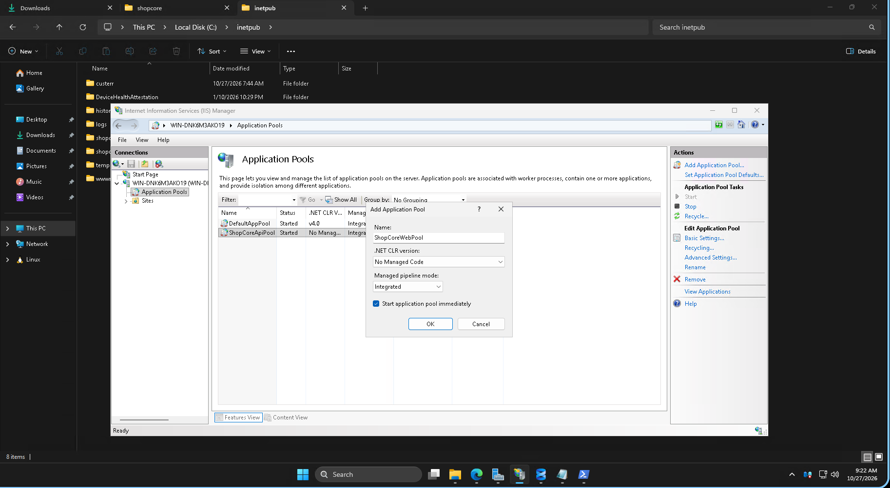

Creación de `ShopCoreWebPool` con la misma configuración, para aislar la tienda de la API.

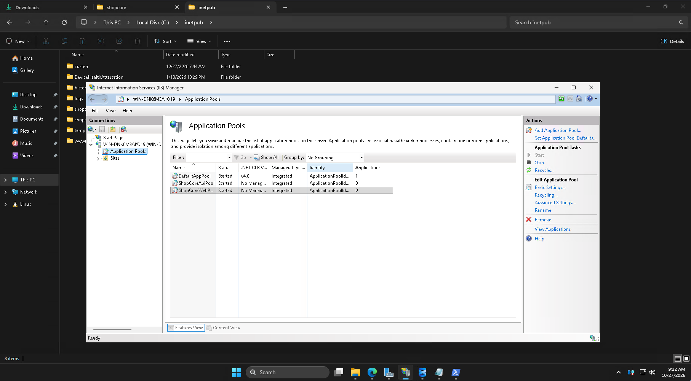

Lista final: `ShopCoreApiPool` y `ShopCoreWebPool` en estado *Started*, *No Managed Code*, *Integrated*.

### 2.3 Sitio de la API: certificado, ruta física y binding
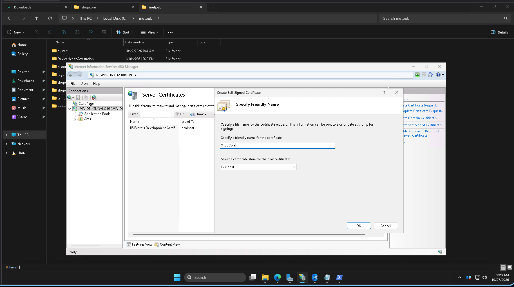

Creación del certificado autofirmado `ShopCore` (almacén *Personal*) en *Server Certificates*, usado por el binding HTTPS de la API.

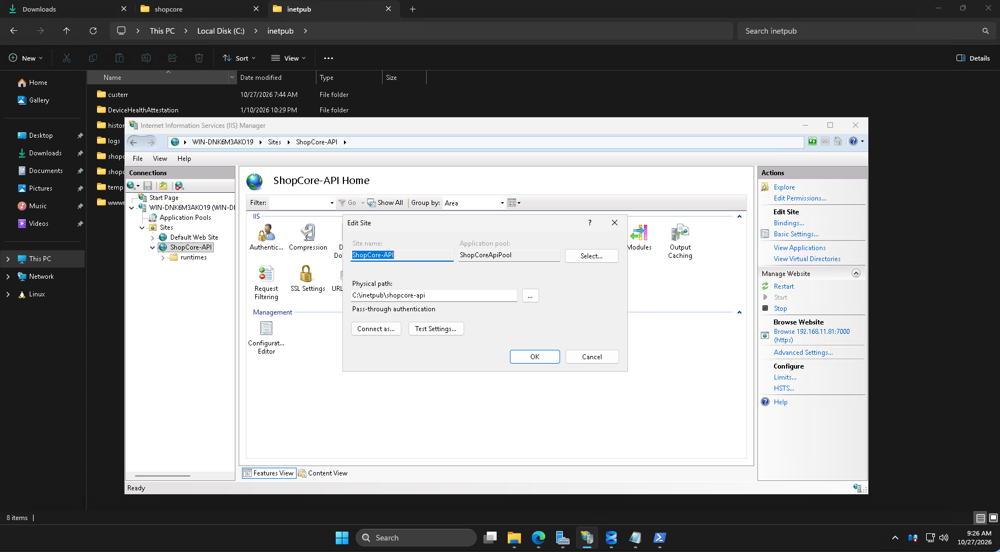

Sitio `ShopCore-API` → *Basic Settings*: Application pool `ShopCoreApiPool`, ruta física `C:\inetpub\shopcore-api`. En *Browse Website* se ve el binding `192.168.11.81:7000 (https)`.

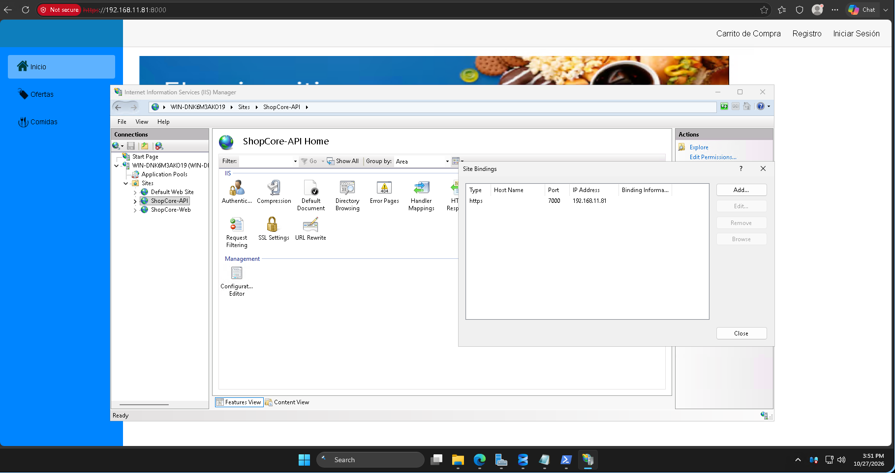

*Site Bindings* de `ShopCore-API`: tipo **https**, puerto **7000**, IP `192.168.11.81`.

### 2.4 Sitio de la tienda: ruta física y binding
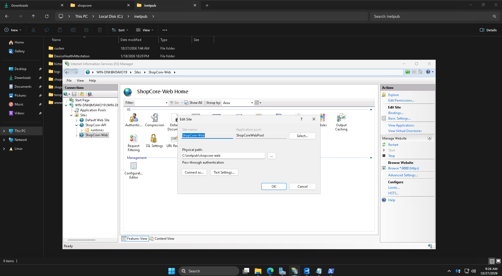

Sitio `ShopCore-Web` → *Basic Settings*: Application pool `ShopCoreWebPool`, ruta física `C:\inetpub\shopcore-web`. En *Browse Website* se ve el binding `*:8000 (https)`.

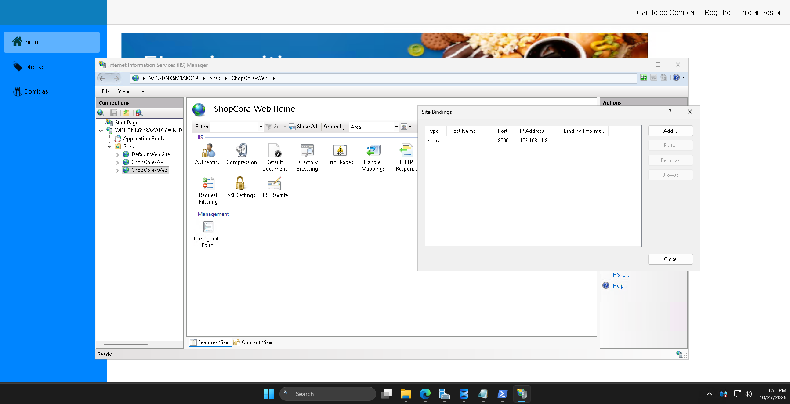

*Site Bindings* de `ShopCore-Web`: tipo **https**, puerto **8000**, IP `192.168.11.81`.

### 2.5 Documento predeterminado
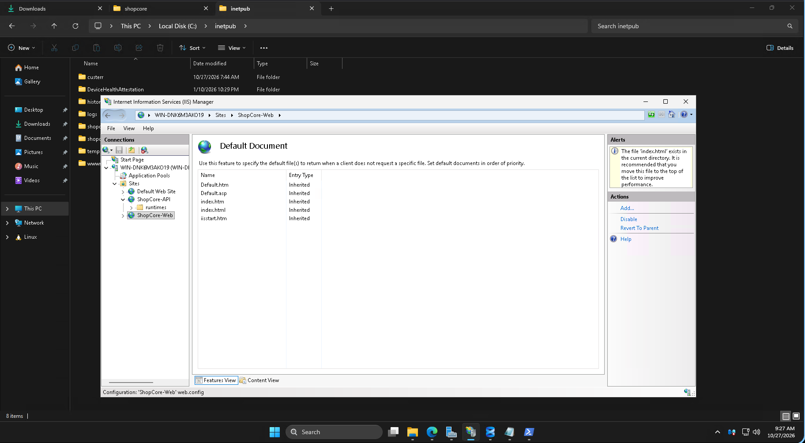

*Default Document* del sitio `ShopCore-Web`: `index.html` está en la lista. Es el punto de entrada de la aplicación Blazor WebAssembly.

### 2.6 Configuración de producción (valores sensibles ocultos)
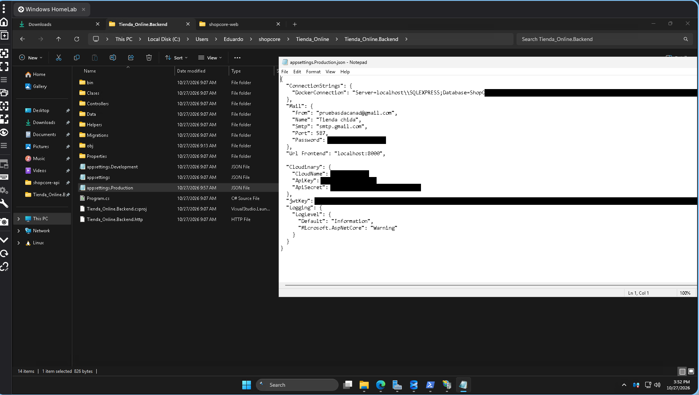

`appsettings.Production.json` del Backend con la cadena de conexión `DefaultConnection` hacia `localhost\SQLEXPRESS`, la configuración de correo, Cloudinary y `jwtKey`. Las contraseñas y claves aparecen tapadas. El archivo está excluido del repositorio (`.gitignore`) y se incluye en la publicación con `dotnet publish`.

### 2.7 Aplicación funcionando en el navegador
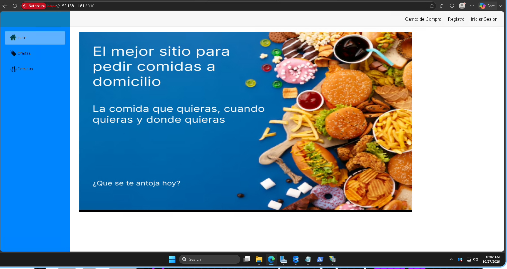

Tienda ShopCore cargada desde IIS (sitio `ShopCore-Web`, puerto 8000), con el menú (Inicio, Ofertas, Comidas) y las opciones Carrito de Compra, Registro e Iniciar Sesión.

### 2.8 Comprobación de salud (`/health`)
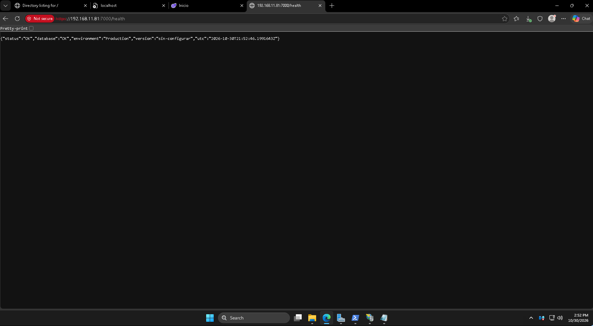

Endpoint `/health` de la API en `https://192.168.11.81:7000/health` respondiendo `{"status":"OK","database":"OK","environment":"Production",...}`: la API corre en entorno **Production** y se conecta correctamente a SQL Server Express.

---

## Comprobación rápida

- Tienda: `https://192.168.11.81:8000`
- API: `https://192.168.11.81:7000/api/productos`
- Health: `https://192.168.11.81:7000/health`
